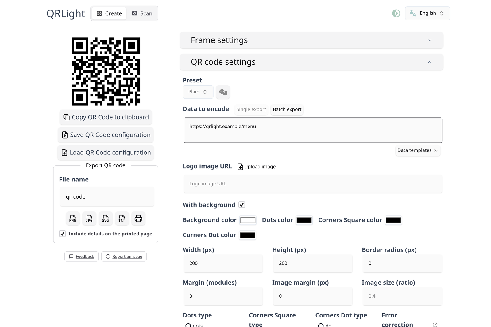
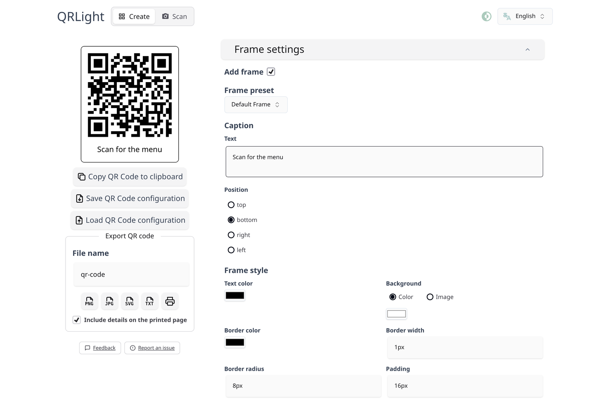
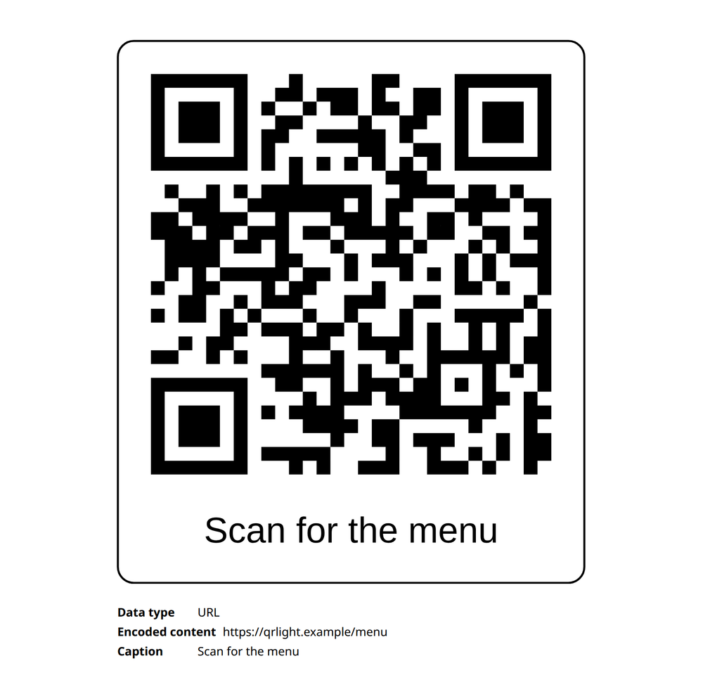
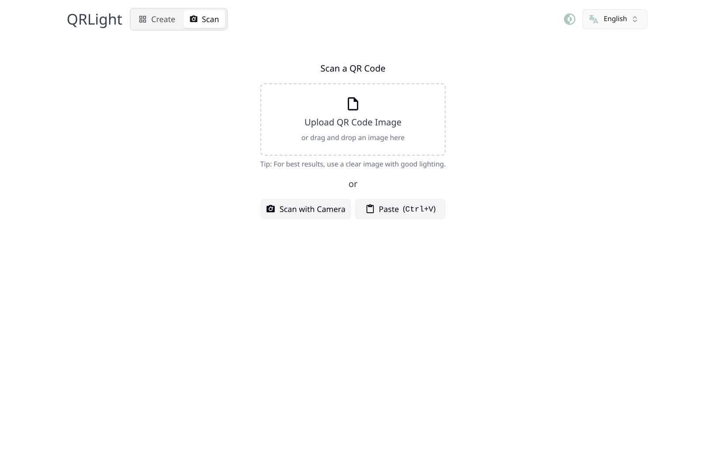
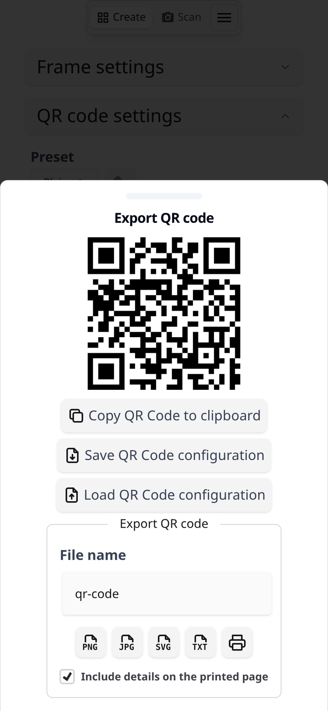
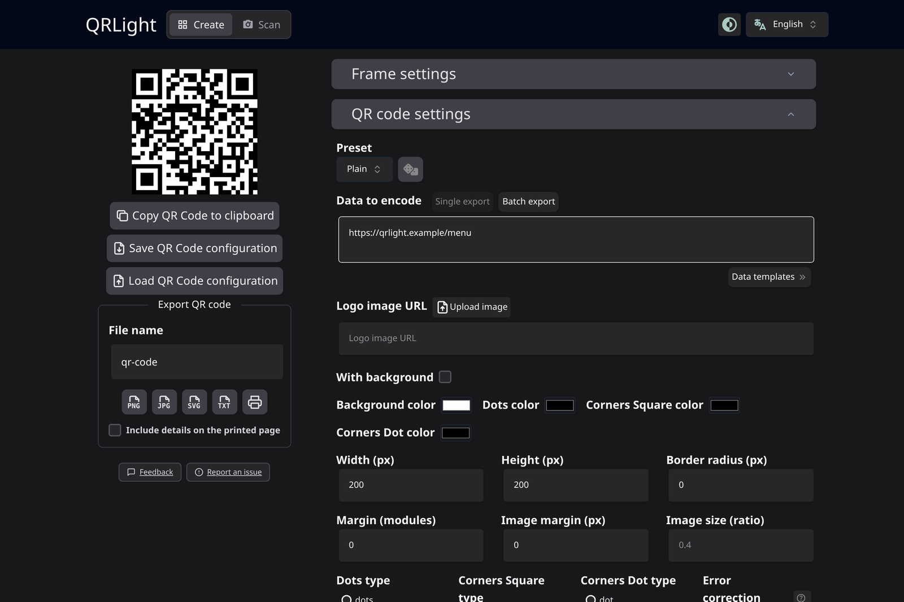

<div align="center">

# QRLight

A self-contained QR code generator and scanner, with a first-class **Print**
action and **WPA3** Wi-Fi codes.

QRLight is a fork of [Mini QR](https://github.com/lyqht/mini-qr) by Estee Tey
(GPL-3.0). The fork exists to add two things — printing a code together with
its frame and caption, and Wi-Fi codes that work with WPA3-only access points —
and to drop the upstream update check so the app never phones home. Everything
else is upstream's work.

</div>

<!-- buttons -->
[](https://github.com/ivancarlosti/qrlight/stargazers)
[](https://github.com/sponsors/ivancarlosti)
[](https://github.com/sponsors/ivancarlosti)
[](https://github.com/ivancarlosti/qrlight/releases)
[](https://github.com/ivancarlosti/qrlight/pulse)
[](https://github.com/ivancarlosti/qrlight/issues)  
[](LICENSE)
[](https://github.com/ivancarlosti/qrlight/commits)
[](https://github.com/ivancarlosti/qrlight/security)
[](https://github.com/ivancarlosti/qrlight?tab=coc-ov-file)
<!-- endbuttons -->

## Features

- **Print** — sends the code to the browser print dialog exactly as previewed:
  same dots, corners, logo, frame, caption and colours. Optionally prints a
  details block underneath: the data type and exact encoded payload (so the paper
  code can be re-created later), or — for Wi-Fi codes — a card with the network
  name, password, security and hidden flag so a visitor can also join by hand.
- **All code types** — text, URL, e-mail, phone, SMS, Wi-Fi, vCard, location,
  calendar event and SEPA payment; printing goes through the same SVG export path,
  so every type prints identically.
- **WPA3 (SAE) Wi-Fi codes** — besides the classic `WPA/WPA2/WPA3` token, the
  Wi-Fi form can emit the explicit `T:SAE` token used for WPA3-Personal networks
  that reject WPA2 clients.
- **Design controls** — dot styles and colours, corner styles, gradients, logos,
  frames with captions and Google Fonts.
- **One bundled preset** — Plain, a neutral print-friendly style, is the default
  and the only design preset that ships. Deployments can replace the list with
  their own designs via `VITE_QR_CODE_PRESETS`.
- **Export** — PNG, JPG, SVG, ASCII/Unicode text, batch export from CSV, and
  copy-to-clipboard.
- **Scanner** — scan codes with the camera or from an image file.
- **Offline PWA** — installable, and every feature works without a backend.
- **No update check** — nothing in this fork polls a remote endpoint.

## Screenshots

|                                                                                 |                                                                                 |
| ------------------------------------------------------------------------------- | ------------------------------------------------------------------------------- |
| **Create** — Plain preset (the default)                                         | **Frame and caption** — print-ready output                                      |
|  |  |
| **Print preview** — code, caption, details                                      | **Scan** — camera or image file                                                 |
|                             |                                  |
| **Mobile** — export bottom sheet                                                | **Dark mode** — follows the system theme                                        |
|                    |            |

Screenshots live in `docs/screenshots/` and are generated with `pnpm screenshots`
(Playwright plus a throwaway dev server).

## Getting started

Requirements: Node.js 22.12 or newer (Node 26 LTS recommended, see
`.tool-versions`) and [pnpm](https://pnpm.io) 12. pnpm settings (dependency
overrides, build approvals, audit exceptions) live in `pnpm-workspace.yaml`;
`package.json` only pins the manager version through `packageManager`.

```bash
pnpm install
pnpm dev          # http://localhost:5173
```

Other scripts:

| Command                     | What it does                                                                |
| --------------------------- | --------------------------------------------------------------------------- |
| `pnpm build`                | Production build into `dist/`                                               |
| `pnpm preview`              | Serve the production build locally                                          |
| `pnpm vitest run`           | Unit and browser tests                                                      |
| `pnpm test:e2e`             | Playwright end-to-end tests (needs `pnpm exec playwright install chromium`) |
| `pnpm type-check`           | `vue-tsc --noEmit`                                                          |
| `pnpm lint` / `pnpm format` | ESLint / Prettier                                                           |
| `pnpm screenshots`          | Regenerates the README screenshots into `docs/screenshots/`                 |
| `pnpm sync-i18n`            | Adds missing `t()` keys to `locales/en.json`                                |
| `pnpm check:i18n`           | Fails when a translation bundle drifts out of sync with `en.json`           |

## Dependency security

`pnpm audit` is clean apart from one accepted, documented advisory. Run it after
any dependency bump; a stale lockfile is how the previous `source-map-js`
advisory (GHSA-68fv-2mgg-jv7q) survived two copies of the package, one of them
vulnerable, for several releases.

Four transitive packages are pinned with `overrides` in `pnpm-workspace.yaml`
because the packages consuming them still declare ranges that resolve below the
patched release:

| Override                                                     | Reason                                                                                                 |
| ------------------------------------------------------------ | ------------------------------------------------------------------------------------------------------ |
| `source-map-js` → `^1.2.2`                                   | GHSA-68fv-2mgg-jv7q (high) — patched in 1.2.2, but parents allowed `1.0.0` and the lockfile kept 1.2.1 |
| `minimatch` → `^11.0.3`                                      | GHSA-g3hv-75wg-m249 (moderate) — `@typescript-eslint/typescript-estree` still allows `<11.0.1`         |
| `glob@>=11` → `^14.0.3`                                      | GHSA-3g3m-2fjr-6pw4 (moderate) — `workbox-build` asks for `^11`, which is inside the vulnerable range  |
| `@tailwindcss/typography>postcss-selector-parser` → `^6.1.5` | GHSA-rj75-hqrm-r3gf (moderate) — the plugin pins the vulnerable 6.x line; 7.x is not API compatible    |

Every override is build-time only; nothing here reaches the bundled application.

**Accepted advisory.** `deepmerge@4.3.1` (GHSA-gcqx-w48m-w2h4 / CVE-2026-93753,
low, prototype pollution) has no patched release — the advisory lists the patched
range as `<0.0.0`. It is reachable only through
`vite-plugin-pwa → workbox-build → @rollup/plugin-node-resolve`, i.e. during
`pnpm build`, from data the project controls. It is listed under `audit.ignore`
in `pnpm-workspace.yaml` so `pnpm audit` keeps reporting real regressions; drop
the entry once `@rollup/plugin-node-resolve` no longer depends on `deepmerge`, or
a fixed release ships.

**New releases are quarantined for a day.** pnpm 12 refuses to install a version
published less than 24 hours ago, including versions already recorded in the
lockfile, which stops a compromised release from reaching a machine before the
registry pulls it. A dependency bump may therefore need a day before
`pnpm install` accepts it. Versions vetted in the current lockfile are exempted
by exact version in `minimumReleaseAgeExclude`; `minimumReleaseAgeExcludePrune`
removes each entry once the lockfile stops resolving it, so the list empties
itself. Do not replace those entries with name patterns — that would exempt the
package from the quarantine permanently.

**Lockfile format.** pnpm 12 writes `pnpm-lock.yaml` as two YAML documents: the
first holds only the pnpm version, the second the dependency graph. A scanner or
SBOM tool that reads just the first document reports zero dependencies and zero
vulnerabilities instead of failing, so check the tool before trusting its output.

**TypeScript stays on 6.x on purpose.** `typescript@7` is the native (Go)
compiler: its package no longer contains the classic `lib/typescript.js` API, only
`lib/version.cjs`, `lib/tsc.js` and an `unstable/*` surface. `typescript-eslint@8`
(everything `pnpm lint` and `pnpm type-check` are built on) consumes that classic
API, so 7.x breaks linting and type checking. Bump when `typescript-eslint` and
`vue-tsc` support the native compiler.

## Printing

The **Print** button lives in the _Export QR code_ section, next to PNG/JPG/SVG/TXT.
It renders the same SVG that _Download SVG_ produces (frame, caption and logo
included), mounts it into a print-only sheet and opens the browser print dialog.
The dialog is opened only after the code is in the DOM and its images and fonts
have decoded, because browsers snapshot the page when `print()` is called — an
earlier snapshot reaches paper printers with an empty code area.

- `Include details on the printed page` (on by default) adds the generic details
  block under the code.
- For Wi-Fi payloads the credentials card is **always** printed, whether or not
  that checkbox is ticked: the network name (SSID), the password in large
  monospace type, the security mode (`No encryption`, `WEP`, `WPA/WPA2/WPA3` or
  `WPA3 (SAE)`) and, for hidden networks, `Hidden SSID: Yes`. The raw `WIFI:T:…`
  payload is not printed — the card says the same thing in a form a visitor can
  type in. Unticking the checkbox only drops the loose frame caption.
- Every other payload type prints its data type and exact encoded payload, plus
  the frame caption when one is set; unticking the checkbox leaves just the code.
- A transparent QR background is printed as white — paper is opaque, so dots on
  transparent would otherwise be invisible.
- Printing is available for single exports; batch export keeps its ZIP flow.

The sheet is styled by `src/print.css`. While printing, every other element in
`<body>` is hidden, so dialogs, drawers and toasts never reach the paper.

## Translations

QRLight ships seven languages: English (`en`), Portuguese (Brazil, `pt-BR`),
Spanish (`es`), French (`fr`), Chinese Simplified (`zh-HANS`), Hindi (`hi`) and
Arabic (`ar`).

- `SUPPORTED_LOCALES` in `src/utils/i18n.ts` is the only list: it drives the
  `messages` map, the language selector and `pnpm check:i18n`, so a bundle cannot
  be imported without being offered, or offered without being imported.
- The selector labels each language with its own name, taken from the
  `"language"` key of the bundle (`"Français"`, `"العربية"`), so the list stays
  readable — and searchable — whatever language the UI is in.
- The choice is stored in `preferred-language`. Codes written by older builds
  (`ptBR`, `ptPT`, `zhHANS`, `zh`) are mapped to the current ones instead of being
  discarded, and the browser language is used when nothing is stored.
- Arabic sets `<html lang="ar" dir="rtl">` before the first paint. Layout uses
  logical utilities (`ms-`/`me-`, `ps-`/`pe-`, `start-`/`end-`, `text-start`), so
  the mirroring is automatic: reach for those instead of `left-`/`right-`.

### Working on translations

```bash
pnpm sync-i18n    # add every t('…') string missing from locales/en.json
pnpm check:i18n   # fail on missing/stale keys, broken messages, lost {placeholders}
```

`pnpm check:i18n` is what keeps a translated page from silently printing English:
`fallbackLocale` turns a missing string into a fallback, not an error, which is
how the printed Wi-Fi card used to read "Scan to join the Wi-Fi" in every
language. A string that exists only in `en.json` is a failure.

To add a language: copy `locales/en.json` to `locales/<code>.json`, translate the
values, add a `"language"` key holding the language's own name, import the file
and add the code to `SUPPORTED_LOCALES` in `src/utils/i18n.ts`, then run
`pnpm check:i18n`.

## WPA3 Wi-Fi codes

Wi-Fi QR payloads follow the de-facto spec everyone implements
([ZXing](https://github.com/zxing/zxing/wiki/Barcode-Contents#wi-fi-network-config-android-ios-11)):
`WIFI:T:<security>;S:<ssid>;P:<password>;H:<hidden>;;`.

| Option in the form | Payload    | When to use it                                                                               |
| ------------------ | ---------- | -------------------------------------------------------------------------------------------- |
| No encryption      | `T:nopass` | Open network                                                                                 |
| WEP                | `T:WEP`    | Legacy WEP                                                                                   |
| WPA/WPA2/WPA3      | `T:WPA`    | Default. Android and iOS negotiate the strongest protocol the network offers, including WPA3 |
| WPA3 (SAE)         | `T:SAE`    | Networks that only accept WPA3-Personal (SAE) clients                                        |

Scanned codes are normalised back into these four options, so `T:wpa2`,
`T:WPA3`, `T:sae` and mixed-case tokens all round-trip into the form instead of
silently becoming an open network.

## Configuration

Copy `docker/.env.example` to `.env` in the repository root and adjust as needed.
All variables are inlined at build time (`VITE_*`) except `BASE_PATH`. The same
example file also holds the Docker Compose overrides — see [Docker](#docker).

| Variable                                   | Default | Description                                                              |
| ------------------------------------------ | ------- | ------------------------------------------------------------------------ |
| `BASE_PATH`                                | `./`    | Base path the app is served from, e.g. `/qrlight`                        |
| `VITE_DEFAULT_PRESET`                      | `Plain` | Preset used for a fresh session                                          |
| `VITE_DEFAULT_DATA_TO_ENCODE`              | –       | Pre-filled data for the create form                                      |
| `VITE_QR_CODE_PRESETS`                     | `Plain` | JSON array of preset objects; replaces the built-in preset list entirely |
| `VITE_FRAME_PRESET` / `VITE_FRAME_PRESETS` | –       | Default / whitelisted frame presets                                      |
| `VITE_HIDE_CREDITS`                        | `false` | Hides the footer credit line                                             |
| `VITE_DISABLE_LOCAL_STORAGE`               | `false` | Disables persisting the design in `localStorage` (never the payload)     |
| `VITE_ENABLE_ANALYTICS`                    | `false` | Enables Vercel Web Analytics                                             |
| `VITE_QR_CREATE_SIMPLE_FULL_MODE_TOGGLE`   | `false` | Shows the Simple/Full mode toggle                                        |
| `VITE_FIELDS_VISIBLE`                      | –       | Comma-separated field keys for a fixed Simple mode                       |

## Docker

The published image is `ghcr.io/ivancarlosti/qrlight:latest`. It is built from
this repository's `Dockerfile` and pushed by `.github/workflows/build.yml` on
every release (`:latest` follows the newest `vX.Y.Z` tag), so nothing has to be
built locally. `docker/docker-compose.yml` runs that image and has no build step:

```bash
docker compose -f docker/docker-compose.yml pull
docker compose -f docker/docker-compose.yml up -d
```

The app is then served on <http://localhost:8080>; `docker compose -f
docker/docker-compose.yml down` stops it, and `... logs -f` follows the output.
The container is checked through a `node -e fetch(...)` healthcheck, since
`wget`/`curl` are not guaranteed by the Alpine base.

To pin a version instead of `:latest`, change the published port or rename the
container, copy `docker/.env.example` to `docker/.env` and edit `QRLIGHT_IMAGE`,
`QRLIGHT_PORT` or `QRLIGHT_CONTAINER_NAME`. Compose reads the `.env` that sits
next to the compose file passed with `-f`, which is why the copy stays in
`docker/`.

The image is a two-stage build: Node builds the static bundle, then a slim
runtime serves `dist/` on port 8080. The build bakes in
`VITE_DEFAULT_PRESET=Plain`, `VITE_HIDE_CREDITS=true` and
`VITE_DISABLE_LOCAL_STORAGE=true`. Those values are compiled into the published
image, so runtime environment variables cannot change them: build your own image
from the `Dockerfile` if you want the full experience.

## Differences from upstream

| Change                   | Notes                                                                        |
| ------------------------ | ---------------------------------------------------------------------------- |
| Removed the update check | No polling of a remote version endpoint                                      |
| No in-app changelog      | Version badge and changelog dialog removed; releases stay on GitHub Releases |
| Added printing           | `QRCodePrintSheet.vue`, `src/print.css`, `printDetails.ts`                   |
| Added WPA3 (SAE)         | `WifiEncryption` gained `SAE`; scanned aliases are normalised                |
| Rebranded                | QRLight naming, locales and PWA manifest; upstream credit kept               |
| Translations             | Seven bundles in `locales/`, checked by `pnpm check:i18n`                    |
| Single preset            | Only the neutral `Plain` design ships; the branded samples were removed      |
| Vendored source          | Built straight from this repository, no upstream clone during `docker build` |

Upstream version this fork tracks: **Mini QR v0.33.0**.

## Credits and licence

QRLight is free software under the [GNU GPL v3](LICENSE), the same licence as
upstream. It is based on [Mini QR](https://github.com/lyqht/mini-qr) by
[Estee Tey](https://esteetey.dev) and its contributors; see [NOTICE.md](NOTICE.md)
for the full attribution. The internal QR renderer, presets, translations and
test suites come from that project.

<!-- footer -->
---

## 🧑‍💻 Consulting and technical support
* For personal support and queries, please submit a new issue to have it addressed.
* For commercial related questions, please [**contact me**][ivancarlos] for consulting costs.

[cc]: https://docs.github.com/en/communities/setting-up-your-project-for-healthy-contributions/adding-a-code-of-conduct-to-your-project
[contributing]: https://docs.github.com/en/articles/setting-guidelines-for-repository-contributors
[security]: https://docs.github.com/en/code-security/getting-started/adding-a-security-policy-to-your-repository
[support]: https://docs.github.com/en/articles/adding-support-resources-to-your-project
[it]: https://docs.github.com/en/communities/using-templates-to-encourage-useful-issues-and-pull-requests/configuring-issue-templates-for-your-repository#configuring-the-template-chooser
[prt]: https://docs.github.com/en/communities/using-templates-to-encourage-useful-issues-and-pull-requests/creating-a-pull-request-template-for-your-repository
[funding]: https://docs.github.com/en/articles/displaying-a-sponsor-button-in-your-repository
[ivancarlos]: https://ivancarlos.me
